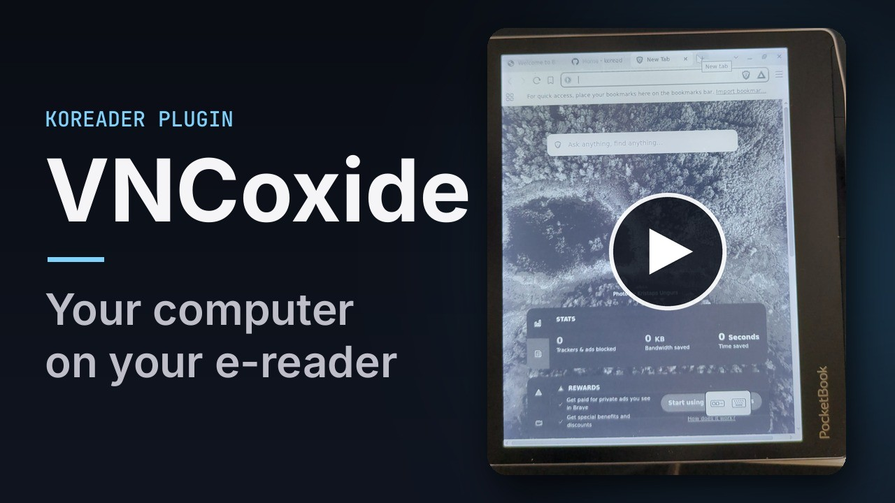
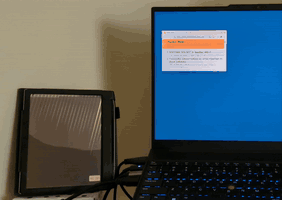

# VNCoxide

**A full-screen VNC viewer for e-readers running [KOReader](https://koreader.rocks), tuned for e-ink.**
Use your reader as a second screen, a remote terminal or a distraction-free display: drive the remote
desktop by touch, on-screen keyboard or physical keyboard.

Pure Lua and LuaJIT FFI, built only on what KOReader already ships: nothing to compile, no native
component. Works with standard VNC servers (x11vnc, TigerVNC, TightVNC, …).

▶ **[Watch the feature tour on YouTube](https://youtu.be/vbbjLrvFx6k)** (4.5 min)

## Highlights

1. **Built for e-ink.** A fast rendering path that keeps typing and paging responsive on modest
   hardware, *sharp* or *smooth* scaling, contrast and inversion for any desktop theme.
2. **Tuned to your network.** Quality presets, per-connection colour depth, Tight/JPEG and
   compression, and a built-in benchmark that measures which combination is fastest for you.
3. **Three pointer modes:** *Touch* (click where you tap), *Mouse* (trackpad-style pointer) and
   *Hybrid* (drag scrolls, tap clicks). Pinch to zoom, two fingers to pan, long press for right click
   and drag.
4. **Full keyboard access.** A modifier strip above the on-screen keyboard, a Send keys panel for
   shortcuts, function keys and Ctrl+Alt+Del, and physical keyboard support.
5. **A floating toolbar** you can move, collapse and configure.
6. **Set up once.** Saved connections, auto-connect at KOReader start, automatic reconnect, sessions
   that stay alive while you read a book, orientation that follows the remote screen.

## Install

1. Download the repository (**Code ▸ Download ZIP**) and unpack it.
2. Rename the folder to **`vncoxide.koplugin`**: KOReader only loads folders ending in `.koplugin`.
3. Copy it into KOReader's `plugins` directory and restart KOReader.

## Quick start

1. Start a VNC server on your computer.
2. On the reader: file browser menu ▸ **More tools ▸ VNC viewer ▸ New connection…**, then enter the
   host, port (default 5900) and password.
3. Tap the connection. Swipe down in the top strip of the screen to show or hide the toolbar;
   **⋯ ▸ Help** lists every gesture and button.

## Documentation

| Document | For |
| --- | --- |
| [User Guide](docs/USER_GUIDE.md) | Concepts, picture tuning, the benchmark, troubleshooting. |
| [Screen tools](tools/screen-tools/README.md) | Giving the reader its own virtual monitor (recommended). |
| [NOTES.txt](NOTES.txt) | Architecture, internals, tests: for reading or changing the code. |
| **⋯ ▸ Help** in the viewer | A complete reference of gestures, buttons and menus, on the device. |

## Recommended: give the reader its own screen

Mirroring a large desktop on a small, differently shaped panel means panning around tiny text. The
[screen tools](tools/screen-tools/README.md) (Linux/Xorg) instead add a **virtual monitor sized for
your reader** and serve only that over VNC: drag a window onto it and it appears on the reader,
fullscreen apps fill the panel exactly, and your other monitors stay private. Profiles for 28
common e-readers are included, each with a `_halfsize` variant that makes applications twice as
large and comfortable to read.

## Security

VNC is unencrypted and VNC Authentication is a weak, DES-based scheme. Passwords are stored in clear
text in KOReader's `settings/vncoxide.lua`, as KOReader does for OPDS and sync credentials. Use a
trusted network, or tunnel through SSH or WireGuard. Never expose a VNC server to the internet.

## Contributing

Bug reports and patches are welcome. Two headless suites cover the code: `tests/proto_smoke.lua`
(protocol stack against a mock RFB server) and `tests/ui_smoke.lua` (dialogs and viewer on
KOReader's real widget stack). How to run them, the architecture and what has been verified are in
[NOTES.txt](NOTES.txt).

## Support

VNCoxide is free and open source. If it is useful to you, sponsoring helps keep it maintained and
moving forward:

## Credits

VNCoxide began as a fork of [vnc.koplugin](https://github.com/hwhw/vnc.koplugin) by Hans-Werner
Hilse, a promising proof of concept, and has since been substantially rewritten. The interface draws
inspiration from [RustDesk](https://rustdesk.com/); the projects share no code.

## License

Copyright © 2026 Kopiás Csaba.
Portions copyright © 2026 Hans-Werner Hilse (the original
[vnc.koplugin](https://github.com/hwhw/vnc.koplugin)), modified by Kopiás Csaba since 2026-11-06.

Licensed under the **GNU Affero General Public License v3.0**, like the original; see
[`LICENSE`](LICENSE). Source: <https://github.com/KopiasCsaba/vncoxide.koplugin>.
Provided **without warranty** of any kind.
